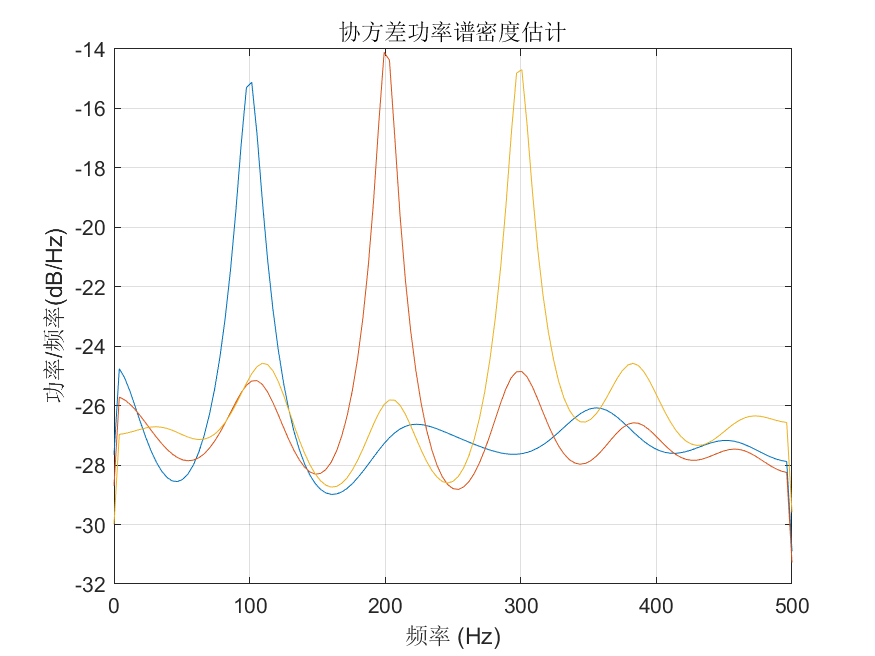

# MATLAB | Spectral Analysis Algorithm | Covariance Power Spectrum Density Estimation | Include data and plotting code | Directly Useable

1. Basic Definition
Covariance Power Spectral Density Estimation is a spectral estimation method based on covariance analysis, which can perform frequency analysis on time-domain signals to obtain the energy distribution of signals at different frequencies. Covariance Power Spectral Density Estimation has high precision and stability, and is widely used in signal processing, communication, acoustics, and other fields. The steps for Covariance Power Spectral Density Estimation are as follows:
Given a time-domain signal x(n) with a length of N.
Perform preprocessing operations such as windowing and FFT on the signal to obtain its frequency domain representation.
Based on the frequency domain representation, obtain the signal's covariance matrix, that is: C(ω) = E[X(ω) * X^H(ω)] where X(ω) is the frequency domain representation of the signal at frequency ω, X^H(ω) is the conjugate transpose of X(ω), and E[.] denotes expectation.
Calculate the power spectral density estimation value of the signal using the covariance matrix: P(ω) = trace[C(ω)]/M where trace[.] represents the trace operation of a matrix, M is the length of the signal.
The advantage of Covariance Power Spectral Density Estimation is that it can perform high-precision spectral analysis on signals, has good stability and anti-interference properties, and also has a good estimation effect on nonlinear components such as harmonics present in signals. The disadvantage is that this method requires matrix operations, leading to a large computational load, and may not be as effective in estimating higher order harmonics and other higher-order components of signals compared to other methods.
2. Definition and Outline Effects
The outline effects are as follows:
\n        \n          \n          \n          \n          \n            To view this video please enable JavaScript, and consider upgrading to a\n            web browser that\n            supports HTML5 video\n  

## Images

<!-- PAYMENT_BLOCK -->

## Get this dataset

- Payment link (Stripe): [Buy now](https://buy.stripe.com/3cs8yP7sY87d0vu9AB)
- Payment QR code: 

<!-- /PAYMENT_BLOCK -->
